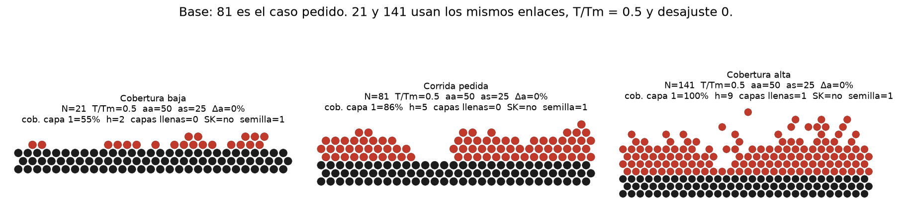
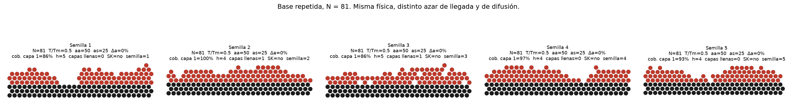
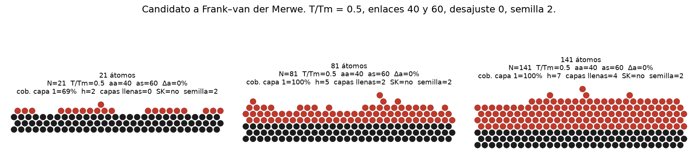
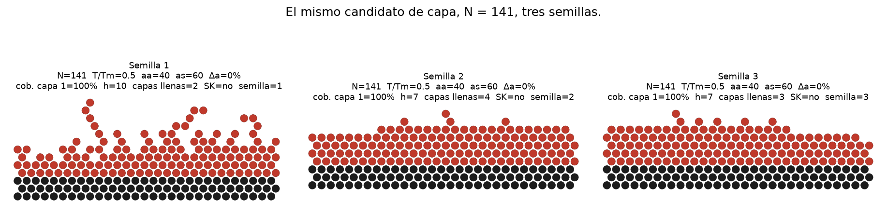
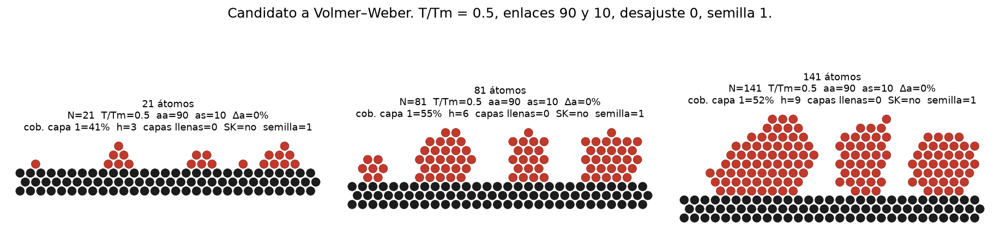
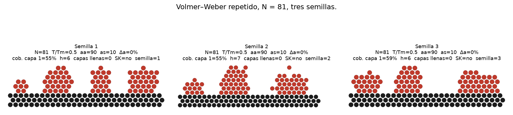
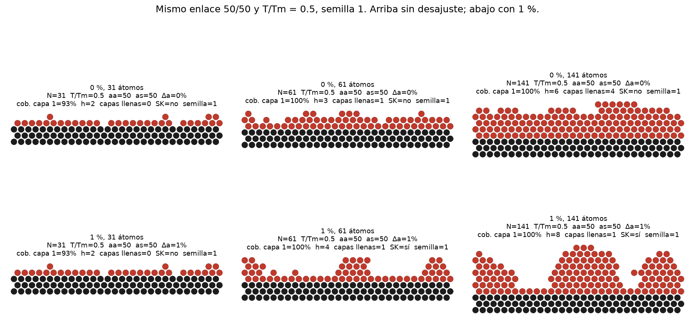
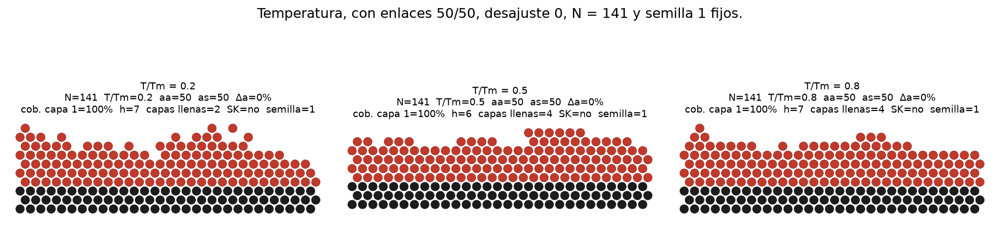
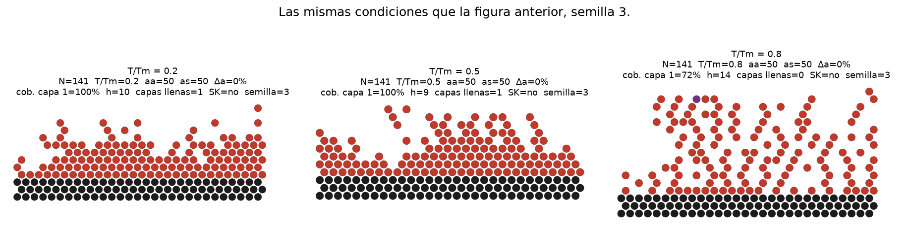

# Problema 3. Simulación de los modos de crecimiento epitaxial

Se usó el simulador de DoITPoMS que está en el repositorio:

`Growth Simulator/simulacion/tlplib/epitaxial-growth/HTML5/epitaxial_growth.html`

No se reescribió la física. Cada corrida carga ese script, fija los controles y avanza el temporizador interno hasta que cae el último átomo. El azar queda sembrado, así que una misma semilla repite la misma configuración. La página se recarga en cada corrida: el botón de reinicio no borra la bandera de la transición ni el desajuste acumulado.

La terraza que el código usa para decidir si una capa está llena tiene 29 sitios (`p = 0…28`). Una monocapa son 29 átomos. 21 átomos son unas 0.7 monocapas, 61 unas 2.1, 81 unas 2.8 y 141 unas 4.9. El slider llega a 151, pero el HTML solo crea los átomos `a1`…`a149`; al intentar depositar el 150 la página lanza un error. Por eso la cobertura alta es 141.

Los enlaces están en las unidades arbitrarias de la página. El desajuste es el número que escribe la caja de texto, seguido de `%`: el slider va de 0 a 100 en pasos de 10 y el script lo divide entre 100. Así, slider 100 se ve como `1 %` y el valor interno `strain` es 1. No son energías de superficie medidas.

Las figuras salen de las coordenadas `(p, q)` que guarda el propio script. El sustrato sólido son las filas `q = 14, 15, 16`. Los círculos negros son sustrato y los rojos, adátomos. La cobertura de sustrato es la fracción de las 29 columnas con un átomo en la capa de contacto.

## (a) Corrida base

Ajustes: **81 átomos, T/Tm = 0.5, enlace adátomo–adátomo 50, enlace adátomo–sustrato 25, desajuste 0**. Semilla 1.

El depósito no es una película plana ni un conjunto de islas separadas. De las 29 columnas, 25 tienen átomo de contacto (cobertura 86 %) y queda un hueco de 4 columnas. Encima de esa capa hay otras cuatro ocupadas: 25, 22, 8 y 1 átomos. La altura máxima es 5, frente a un espesor medio de 2.8 monocapas. Es un bloque rugoso, de unas tres capas en la mayor parte de la terraza, con el sustrato casi cubierto y sin ninguna capa realmente terminada.

Una sola imagen final no alcanza para nombrar el modo:

- No dice en qué orden se llenó. Con los mismos enlaces y la misma semilla, pero solo 21 átomos, ya hay 5 átomos en la segunda capa mientras 13 columnas siguen vacías. La multicapa empieza antes de cubrir el sustrato. La foto de 81 átomos es compatible tanto con una capa que después se arrugó como con islas que después se juntaron. La dosis baja descarta la primera lectura.
- Tampoco es estable entre repeticiones. En las cinco semillas de 81 átomos la cobertura de contacto va de 86 % a 100 %. Solo la semilla 2 cierra la capa de contacto. La semilla 3 llena la segunda capa (29 átomos) con la de contacto todavía en 25. La semilla 1 deja el hueco de cuatro sitios.

La clase cualitativa sí se repite: película rugosa, sustrato casi cubierto, altura por encima del espesor medio. Lo que no se repite es si la primera capa llega a cerrarse.

## (b) Enlaces, con T/Tm = 0.5 y desajuste cero

Se barrieron 18 pares de enlaces a 21, 81 y 141 átomos, con tres semillas. El modo no lo decide solo cuál enlace es mayor. Un enlace adátomo–sustrato muy alto (80 o 100) clava los átomos donde caen, porque la probabilidad de salto lateral lleva el factor `(1 − enlace/100)`. Esas películas cubren el sustrato y después crecen en columnas de altura 10–13. Con el enlace de sustrato solo un poco mayor que el de adátomo (40 frente a 30), la terraza también se cubre y luego se arruga: a 141 átomos la altura media queda cerca de 12 y apenas pasa de una capa llena.

### Frank–van der Merwe, tentativo

El par más cercano a capas sucesivas es **adátomo–adátomo 40, adátomo–sustrato 60**.

| Átomos | Cobertura de contacto | Capas llenas | Altura | Qué se ve |
| --- | --- | --- | --- | --- |
| 21 | 69 % (20/29) | 0 | 2 | Casi una monocapa incompleta. Ya hay 1 átomo en la segunda capa y 9 columnas vacías. |
| 81 | 100 % | 2 | 5 | Las dos primeras capas están llenas. La tercera tiene 19 átomos y todavía hay átomos hasta la quinta. |
| 141 | 100 % | 4 | 7 | Cuatro capas llenas. La quinta tiene 21 átomos y la cola llega a altura 7. El espesor medio es 4.9. |

Hay una capa de mojado continua a partir de 81 átomos, y las capas se completan de abajo hacia arriba mejor que en el resto de la barrida. No cumple el criterio estricto. A 21 átomos la segunda capa ya empezó con la primera abierta. A 141 átomos la semilla 1, con los mismos controles, no es una película plana: altura 10 y solo dos capas llenas. Las semillas 2 y 3 sí se quedan cerca del espesor medio (alturas 7 y 7, con 4 y 3 capas llenas).

Etiqueta: **tentativo**. Es el régimen de capas de esta página, y dos de tres semillas gruesas lo sostienen. No es el crecimiento monocapa por monocapa del libro, y una semilla no lo reproduce.

### Volmer–Weber, apoyado

El par claro es **adátomo–adátomo 90, adátomo–sustrato 10**.

| Átomos | Cobertura de contacto | Capas llenas | Altura | Islas |
| --- | --- | --- | --- | --- |
| 21 | 41 % (12/29) | 0 | 3 | 5 |
| 81 | 55 % (16/29) | 0 | 6 | 4 |
| 141 | 52 % (15/29) | 0 | 9 | 3 |

Desde la dosis baja hay islas de dos y tres capas con la mayor parte del sustrato descubierto. Al añadir átomos las islas crecen hacia arriba y se juntan un poco, pero la cobertura se queda alrededor de la mitad y ninguna capa se llena. No hay capa de mojado continua.

Las otras dos semillas a 81 átomos dan la misma clase: cobertura 55 % y 59 %, altura 7 y 6, cero capas llenas, sustrato todavía abierto.

Lo mismo ocurre con 80/10, 70/20 y 100/0: a 141 átomos la cobertura media queda entre 41 % y 68 % y ninguna semilla cierra la terraza. Etiqueta: **apoyado**.

## (c) Stranski–Krastanov

Primero se buscó un mojado inicial sin desajuste. Con enlaces iguales **50 y 50**, T/Tm = 0.5 y desajuste 0, la semilla 1 sí llena capas: a 61 átomos hay una capa completa y la segunda ya tiene 25 de 29 sitios; a 141 átomos hay cuatro capas completas y la altura solo llega a 6.

Después se repitió esa corrida con desajuste. En el script el desajuste no entra en la energía de los sitios. Solo elige un número crítico de capas llenas:

- menos de 0.3 %: crítico = 20, inalcanzable con 141 átomos;
- 0.3 %: crítico = 3;
- 0.6 %: crítico = 2;
- 0.9 % y 1 %: crítico = 1.

Cuando las capas llenas llegan a ese número, `fudgetransform()` —el comentario del código lo llama *a fudge*— congela esas filas, marca todos sus sitios como ocupados y **duplica** el enlace adátomo–adátomo. Los átomos nuevos siguen sentados en la red del sustrato.

| Desajuste | Átomos | Interruptor | Capas llenas | Altura | Columnas que siguen en una sola capa |
| --- | --- | --- | --- | --- | --- |
| 0 % | 31 | no | 0 | 2 | la primera capa todavía no cierra (cobertura 93 %) |
| 1 % | 31 | no | 0 | 2 | igual que la fila de arriba: el crítico aún no puede cumplirse |
| 0 % | 61 | no | 1 | 3 | 4 |
| 1 % | 61 | sí, el enlace pasa de 50 a 100 | 1 | 4 | 15 |
| 0 % | 141 | no | 4 | 6 | 0 |
| 1 % | 141 | sí | 1 | 8 | 5 |

A 31 átomos las dos películas son la misma: la primera capa no está llena y el desajuste no hace nada. A 61 átomos, sin desajuste, la segunda capa se está completando. Con 1 %, la primera capa queda como mojado y encima crecen islas de altura 4, dejando 15 columnas en una sola capa. Esa comparación se repitió en las tres semillas: las tres disparan el interruptor y las tres dejan 15 columnas expuestas. A 141 átomos el contraste sigue en la semilla 1 (cuatro capas planas contra islas de altura 8 sobre una sola capa llena), pero la semilla 2 ya cierra una segunda capa y tapa el mojado. Con 0.6 % el crítico vale 2, así que a 61 átomos el interruptor todavía no ha disparado y la película es idéntica a la de desajuste cero.

Etiqueta: **apoyado** como morfología a unas 2 monocapas con desajuste de 1 %; **tentativo** en la película gruesa; **no reproducido** a 61 átomos si el desajuste es solo 0.6 %. Lo que se ve es mojado seguido de islas. Lo que no se ve es una energía de deformación ni islas que relajen la red: el espaciado no cambia.

## (d) Temperatura

Se dejó fijo el par 50/50, desajuste 0 y 141 átomos, y se movió solo T/Tm. La temperatura no entra en la energía de un sitio. El script la convierte en un factor de probabilidad,

`100 * exp(((T/Tm − 0.65) / 0.15) − 1)`,

que vale 1.83 a 0.2 Tm, 13.5 a 0.5 Tm y 100 a 0.8 Tm. Con ese factor se aceptan el salto hacia un sitio de menor energía y el paso lateral. Los enlaces, que serían los que fijan el mojado de equilibrio, no cambian.

En la semilla 1, bajar de 0.5 a 0.2 Tm reduce las capas llenas de 4 a 2 y deja más átomos en las capas altas. Subir a 0.8 Tm, en esa semilla, mantiene cuatro capas llenas. No aparece un cambio de modo.

La semilla 3 muestra que el efecto es cinético y además no es monótono. A 0.2 y 0.5 Tm el sustrato se cubre, aunque la superficie ya es rugosa. A 0.8 Tm la cobertura de contacto cae a 72 %, no se llena ninguna capa y la altura llega a 14: columnas separadas por huecos, con sustrato descubierto. El punto morado de esa figura son dos átomos que la página dejó en el mismo sitio. Los enlaces no cambiaron. Lo que cambió es la probabilidad de salto, y esa regla no obedece un balance detallado, así que más temperatura no empuja la película hacia un mojado de equilibrio.

## (e) Reproducibilidad

| Clasificación | Repeticiones | Resultado |
| --- | --- | --- |
| Base, película rugosa con el sustrato casi cubierto | 5 semillas, N = 81 | La clase se mantiene. Que la primera capa cierre, no: solo 1 de 5. |
| Volmer–Weber, 90/10 | 3 semillas en 21, 81 y 141, y también de 0.2 a 0.8 Tm | Siempre hay islas multicapa con el sustrato a medias. Apoyado. |
| Capas, 40/60, N = 141 | 3 semillas | Dos quedan cerca del espesor medio (3 y 4 capas llenas). Una sube a altura 10 con solo 2 capas llenas. Tentativo. |
| Stranski–Krastanov, 50/50, 1 %, N = 61 | 3 semillas | Las tres disparan el interruptor y dejan 15 columnas de una sola capa, frente a 4 o 5 sin desajuste. Apoyado en esa dosis. |
| El mismo par con 0.6 %, N = 61 | 3 semillas | El interruptor no dispara. Igual que desajuste cero. No reproducido. |
| El mismo par con 1 %, N = 141 | 3 semillas | La semilla 1 conserva islas sobre una capa. La 2 ya tapa el mojado. Tentativo. |

De 1262 corridas, 10 se caen con el mismo error de la página: un átomo sale del arreglo `filled` y `secondneighbours` lee una fila inexistente. Esas corridas no entran en la clasificación. El fallo aparece al repetir ciertas semillas con desajuste; recargar y cambiar la semilla lo evita.

## Documentación y modelo

La página [The simulation and its limitations](https://www.doitpoms.ac.uk/tlplib/epitaxial-growth/limitations.php) define los tres modos como en el enunciado: capas que se completan antes de empezar la siguiente, islas que crecen antes de cubrir el sustrato, y una o más capas perfectas seguidas de islas. También dice que el modelo es bidimensional, que la difusión ocurre a lo largo de una línea y que por eso los átomos se encuentran más que en tres dimensiones. Avisa que la red de la pantalla es compacta, no la del diamante de Si o GaAs, y que no se puede cambiar el flujo.

Sobre el desajuste, la misma página afirma: si la diferencia de parámetro de red no es cero, el depósito tiene que deformarse para encajar en el sustrato y por eso se acumula energía de deformación. No da la expresión de esa energía, ni un espesor crítico, ni dice cómo la relajaría una isla (paredes libres, dislocaciones, otro espaciado).

El script no hace esa cuenta. `recalc()` suma vecinos de sustrato, de adátomo y, después del interruptor, de los sitios “fudge”, con pesos 1, 0.3 y 0.1 para primero, segundo y tercer vecino. `strain` no aparece ahí. Las islas no se relajan: siguen en los puntos de la red del sustrato. La morfología de la figura de 1 % es real dentro de la página, pero sale de congelar la primera capa y duplicar el enlace adátomo–adátomo, no de una energía elástica.

Conviene separar las dos cosas. Lo observado es la forma: rugosa en la base, islas con sustrato descubierto si el enlace adátomo–adátomo domina y la difusión no los esparce, capas solo de manera incompleta, y mojado más islas cuando el interruptor de 1 % llega a disparar. Lo que el texto da por supuesto, y el código no calcula, es la energía de deformación y su relajación.

## Tabla de los casos que se clasifican

Cobertura: fracción de las 29 columnas con átomo en contacto con el sustrato. “Mojado” significa esa capa continua. “Multicapa” significa átomos por encima de ella.

| Caso | N | T/Tm | aa | as | Δa | Semilla | Cobertura | Capas llenas | Altura | Multicapa | Mojado continuo | Etiqueta |
| --- | --- | --- | --- | --- | --- | --- | --- | --- | --- | --- | --- | --- |
| Base | 21 | 0.5 | 50 | 25 | 0 | 1 | 55 % | 0 | 2 | sí | no | la foto final no basta |
| Base | 81 | 0.5 | 50 | 25 | 0 | 1 | 86 % | 0 | 5 | sí | no | rugosa, no es un modo limpio |
| Base | 141 | 0.5 | 50 | 25 | 0 | 1 | 100 % | 1 | 9 | sí | sí | sigue rugosa |
| Capas | 21 | 0.5 | 40 | 60 | 0 | 2 | 69 % | 0 | 2 | sí, 1 átomo | no | tentativo |
| Capas | 81 | 0.5 | 40 | 60 | 0 | 2 | 100 % | 2 | 5 | sí | sí | tentativo |
| Capas | 141 | 0.5 | 40 | 60 | 0 | 2 | 100 % | 4 | 7 | sí | sí | tentativo |
| Capas, otra semilla | 141 | 0.5 | 40 | 60 | 0 | 1 | 100 % | 2 | 10 | sí | sí | no reproduce la película plana |
| Islas | 21 | 0.5 | 90 | 10 | 0 | 1 | 41 % | 0 | 3 | sí | no | apoyado |
| Islas | 81 | 0.5 | 90 | 10 | 0 | 1 | 55 % | 0 | 6 | sí | no | apoyado |
| Islas | 141 | 0.5 | 90 | 10 | 0 | 1 | 52 % | 0 | 9 | sí | no | apoyado |
| SK, antes del crítico | 31 | 0.5 | 50 | 50 | 0 y 1 % | 1 | 93 % | 0 | 2 | sí | no | todavía no hay transición |
| SK, sin desajuste | 61 | 0.5 | 50 | 50 | 0 | 1 | 100 % | 1 | 3 | sí | sí | se está llenando la segunda capa |
| SK, con desajuste | 61 | 0.5 | 50 | 50 | 1 % | 1 | 100 % | 1 | 4 | sí, islas | sí | apoyado |
| SK, película gruesa | 141 | 0.5 | 50 | 50 | 1 % | 1 | 100 % | 1 | 8 | sí, islas | sí | tentativo entre semillas |
| Temperatura baja | 141 | 0.2 | 50 | 50 | 0 | 1 | 100 % | 2 | 7 | sí | sí | más rugosa que a 0.5 Tm |
| Temperatura alta | 141 | 0.8 | 50 | 50 | 0 | 3 | 72 % | 0 | 14 | sí | no | efecto cinético, no otro mojado |

Para repetir una figura: desde `Tarea 8/problema3`, `node run_epitaxy.js` corre la base de la semilla 1, y `node run_epitaxy.js --sweep resultados.json` rehace la barrida. `python3 analizar.py --fig resultados.json` vuelve a dibujar las redes.
